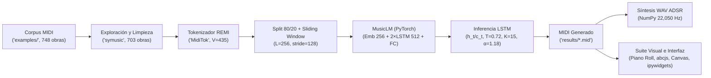

# 🎹 DeepMidi-LSTM: Generación Musical Simbólica mediante Redes Neuronales Recurrentes (LSTM)

[](https://www.python.org/)
[](https://pytorch.org/)
[](https://github.com/Natooz/MidiTok)
[](https://github.com/Yikai-Liao/symusic)
[](LICENSE)

> **Proyecto Integrador Final** — Universidad de Guadalajara · Centro Universitario de Guadalajara (CUGDL)  
> **Plan de Estudios:** Licenciatura en Inteligencia Artificial y Ciencia de Datos  
> **Curso:** Diseño, Visualización y Comprensión de Deep Neural Networks  
> **Profesor:** Heriberto Zapata Solano · **Alumno:** Roberto Alejandro Chagra Martinez (`208447128`)

Sistema integral de aprendizaje profundo para el **procesamiento simbólico MIDI, auditoría y limpieza algorítmica, tokenización causal REMI, entrenamiento de un modelo de lenguaje musical estrictamente LSTM (`MusicLM`), evaluación objetiva, síntesis acústica WAV en Python puro y visualización interactiva animada**.

---

## 📌 Tabla de Contenidos

- [Descripción General](#-descripción-general)
- [Resultados Clave](#-resultados-clave)
- [Arquitectura del Pipeline](#-arquitectura-del-pipeline)
- [Estructura del Repositorio](#-estructura-del-repositorio)
- [Requisitos e Instalación](#-requisitos-e-instalación)
- [Guía de Uso Rápido](#-guía-de-uso-rápido)
- [Fases del Notebook (Partes 0 a 11)](#-fases-del-notebook-partes-0-a-11)
- [Artefactos Generados y Visualizadores](#-artefactos-generados-y-visualizadores)
- [Documentación Técnica](#-documentación-técnica)
- [Licencia](#-licencia)

---

## 🎼 Descripción General

**DeepMidi-LSTM** formula la composición musical como un problema de **Modelado de Lenguaje Autorregresivo (*Next-Token Prediction*)** sobre música simbólica. En lugar de procesar audio crudo o matrices binarias tipo *piano roll* de alta dispersión, cada obra se codifica con el estándar **REMI (*Revamped MIDI*)** de `MidiTok`, preservando explícitamente compases, posiciones rítmicas, alturas tonales, velocidades dinámicas, duraciones, acordes, silencios y tempos.

El cuaderno principal ([`DeepMidi_LSTM_Proyecto_Integrador.ipynb`](DeepMidi_LSTM_Proyecto_Integrador.ipynb)) es **100% reproducible y autocontenido**: resuelve dinámicamente rutas locales o de Google Drive y, si el corpus no está presente, descarga automáticamente la carpeta pública `examples/` mediante `gdown`.

---

## 📊 Resultados Clave

| Indicador | Resultado Verificado |
|---|---|
| **Corpus Explorado (`examples/`)** | **748 archivos MIDI** en **11 géneros** y **81 subcarpetas de artistas** (739 legibles / 9 corruptos; 3,803,835 notas) |
| **Limpieza y Retención** | **703 obras limpias conservadas (94.0%)** · 45 descartadas (6.0%: 33 notas insuficientes, 9 corruptos, 3 fuera de rango) |
| **Tokenización REMI (`MidiTok`)** | **435 tokens únicos** (`PAD_None = 0`) · longitud promedio **3,653.85 tokens/obra** · 100% utilizables ($\ge 64$ tokens) |
| **Preparación LSTM (*Zero Leakage*)** | **562 train / 141 val** obras · ventanas deslizantes ($L=256$, solape 50%): **15,608 train / 4,104 val** (lotes `[32, 255]`) |
| **Arquitectura `MusicLM`** | `Embedding(435, 256)` + `2× LSTM(512, drop=0.2)` + `Linear(512, 435)` → **4,012,723 parámetros entrenables** |
| **Convergencia (GPU CUDA)** | Mejor checkpoint en **época 3 de 8** (*Early Stopping*, paciencia 5): **Val Loss = 1.7945 (PPL = 6.02)** · Train Loss = 1.4208 (PPL = 4.14) |
| **Generación Autorregresiva LSTM** | **1,332 tokens** ($T=0.72$, Top-$K=15$, $\alpha=1.18$) → **348 notas**, **164.23 s** (~2.74 min), pitch **41–72** (prom. **60.88** vs. 60.16 real) |

---

## 🏛 Arquitectura del Pipeline



---

## 📂 Estructura del Repositorio

```text
DeepMidi_LSTM_Generacion_Musical/
├── DeepMidi_LSTM_Proyecto_Integrador.ipynb  # Cuaderno principal ejecutable (Partes 0 a 11 + JSON)
├── README.md                                # Documentación general del proyecto
├── requirements.txt                         # Dependencias de Python
├── LICENSE                                  # Licencia MIT
├── CONTRIBUTING.md                          # Guía de contribución
├── CITATION.cff                             # Metadatos de citación académica
│
├── examples/                                # Corpus MIDI fuente (748 archivos en 11 géneros)
├── dataset_midi_clean/                      # 703 pistas depuradas monopista (clean_*.mid)
│
├── results/                                 # Artefactos y salidas verificadas del pipeline
│   ├── parte2_exploracion.png               # Métricas acústicas y estructurales del corpus
│   ├── parte3_limpieza.png                  # Tasa de retención y causas de descarte
│   ├── parte5_histograma_longitudes.png     # Distribución KDE de longitudes REMI
│   ├── train_sequences.npz                  # Secuencias tokenizadas de entrenamiento (562)
│   ├── val_sequences.npz                    # Secuencias tokenizadas de validación (141)
│   ├── preparacion_avance_lstm.json         # Resumen de preparación de tensores
│   ├── parte7_mejor_modelo.pt               # Checkpoint óptimo de MusicLM (época 3)
│   ├── parte7_historial.json                # Historial de pérdidas por época (8 épocas)
│   ├── parte7_curvas_perdida.png            # Curvas Cross-Entropy Train vs. Val
│   ├── mi_primera_composicion_ia_remi.mid   # Composición MIDI original generada por la LSTM
│   ├── mi_primera_composicion_ia_remi.wav   # Audio sintetizado en WAV 16-bit / 22,050 Hz
│   ├── parte9_evaluacion.png                # Comparativa métrica Real vs. Generada
│   ├── parte10_piano_roll_generada.png      # Piano Roll dinámico (viridis)
│   ├── partitura_composicion_generada.html  # Partitura animada sincronizada (abcjs)
│   ├── animacion_composicion_generada.html  # Visualizador de notas cayendo (Canvas + Web Audio)
│   ├── composicion_interfaz_lstm.mid / .wav # Salidas generadas desde el panel ipywidgets
│   └── resultados_finales.json              # Consolidado reproducible de métricas y rutas
│
└── docs/                                    # Documentación técnica especializada
    ├── DOCUMENTO_TECNICO.md                 # Fundamentos teóricos, matemáticas y evaluación
    ├── DICCIONARIO_FUNCIONES.md             # Referencia completa de la API y clases del notebook
    └── DIAGRAMAS.md                         # Diagramas Mermaid de flujo y arquitectura
```

---

## 💻 Requisitos e Instalación

### Opción 1: Google Colab (Recomendada con GPU CUDA)
1. Sube o abre [`DeepMidi_LSTM_Proyecto_Integrador.ipynb`](DeepMidi_LSTM_Proyecto_Integrador.ipynb) en Google Colab con acelerador **GPU**.
2. Ejecuta **Entorno de ejecución → Ejecutar todas**: la Parte 0 instala selectivamente las dependencias faltantes y descarga `examples/` automáticamente vía `gdown` si no está en Drive.

### Opción 2: Ejecución Local (Windows / Linux / macOS)
```bash
# 1. Clonar el repositorio
git clone https://github.com/tu-usuario/DeepMidi_LSTM_Generacion_Musical.git
cd DeepMidi_LSTM_Generacion_Musical

# 2. Crear y activar entorno virtual
python -m venv .venv
# Windows (PowerShell):
.\.venv\Scripts\Activate.ps1
# Linux / macOS:
source .venv/bin/activate

# 3. Instalar dependencias
python -m pip install --upgrade pip
python -m pip install -r requirements.txt
```

---

## 🚀 Guía de Uso Rápido

Inicia Jupyter y ejecuta secuencialmente todas las celdas de [`DeepMidi_LSTM_Proyecto_Integrador.ipynb`](DeepMidi_LSTM_Proyecto_Integrador.ipynb):

```bash
jupyter lab DeepMidi_LSTM_Proyecto_Integrador.ipynb
# o:
jupyter notebook DeepMidi_LSTM_Proyecto_Integrador.ipynb
```

> **Tip:** En la Parte 7, la bandera `REENTRENAR = False` restaura instantáneamente el checkpoint validado (`results/parte7_mejor_modelo.pt`) entrenado en GPU para ejecutar inferencia, evaluación, síntesis y visualizadores incluso en CPU. Cambia a `REENTRENAR = True` para entrenar desde cero.

---

## 🔄 Fases del Notebook (Partes 0 a 11)

| Parte | Sección | Descripción Técnica |
|---|---|---|
| **0** | **Preparación del Entorno** | Instalación selectiva, fijación de semilla (`SEED=42`), detección CUDA/CPU y resolución dinámica de rutas (`gdown`). |
| **1** | **Adquisición y Selección** | Exploración jerárquica de 11 géneros, 81 artistas y 748 archivos MIDI en `examples/`. |
| **2** | **Exploración MIDI** | Auditoría con `symusic`: duración, notas, multipista, percusión, top 10 instrumentos GM y ajuste a piano (21–108). |
| **3** | **Limpieza y Preparación** | Detección de corruptos, exclusión de percusión, priorización de piano GM 0–7 (o mayor densidad) y descarte de 45 obras. |
| **4** | **Tokenización REMI** | Configuración de `MidiTok` REMI ($V=435$), ejemplos de tokens/IDs y verificación reversible `tokenizer.decode()`. |
| **5** | **Análisis Estadístico** | Mínimo, máximo, promedio, mediana, desviación estándar, P95, histograma KDE y viabilidad ($\ge 64$ tokens). |
| **6** | **Preparación para LSTM** | División 80/20 por canción (*zero leakage*), ventanas deslizantes ($L=256$, solape 50%) y `DataLoader` verificados `[32, 255]`. |
| **7** | **Modelo, Hiperparámetros y Entrenamiento** | `MusicLM` (4.01 M parámetros), tabla de hiperparámetros, `AdamW`, *Gradient Clipping*, `ReduceLROnPlateau` y *Early Stopping*. |
| **8** | **Generación Autorregresiva LSTM** | Propagación continua `(h_t, c_t)`, Temperatura `0.72`, Top-K `15`, *Repetition Penalty* `1.18`, inicio en `0:00` y decodificación REMI. |
| **9** | **Métricas y Evaluación Objetiva** | Loss y Perplejidad del modelo + comparativa musical (rango, centro tonal, densidad y articulación) frente a 141 obras reales. |
| **10** | **Síntesis y Exportación WAV** | Sintetizador aditivo en NumPy (22,050 Hz / 16 bits PCM, 2.º armónico + envolvente ADSR) con reproductor `Audio`. |
| **11** | **Interfaz y Reproductores Visuales** | Piano Roll (`viridis`), partitura animada `abcjs`, visualizador de notas cayendo (Canvas + Web Audio) y panel `ipywidgets`. |

---

## 🎧 Artefactos Generados y Visualizadores

Tras ejecutar el cuaderno, todos los entregables quedan disponibles en `results/`:
- **MIDI & Audio:** `results/mi_primera_composicion_ia_remi.mid` y `results/mi_primera_composicion_ia_remi.wav`.
- **Visualizadores HTML autónomos** (abribles en cualquier navegador moderno):
  - `results/partitura_composicion_generada.html` — Pentagrama interactivo sincronizado (`abcjs` + Web Audio).
  - `results/animacion_composicion_generada.html` — Notas cayendo tipo *Synthesia* sobre línea dorada «AHORA».
- **Trazabilidad:** `results/resultados_finales.json` concentra todas las métricas, hiperparámetros e historial de entrenamiento.

---

## 📚 Documentación Técnica

- 📘 [**Documento Técnico**](docs/DOCUMENTO_TECNICO.md): Formulación matemática de REMI, compuertas LSTM, entrenamiento, inferencia con *Repetition Penalty*, síntesis aditiva ADSR y evaluación completa.
- 📖 [**Diccionario de Funciones y API**](docs/DICCIONARIO_FUNCIONES.md): Firma, parámetros, retornos y comportamiento de todas las clases, constantes y funciones de `DeepMidi_LSTM_Proyecto_Integrador.ipynb`.
- 📊 [**Diagramas del Sistema**](docs/DIAGRAMAS.md): Diagramas de flujo, decisiones y arquitectura del proyecto.

---

## 📄 Licencia

Distribuido bajo licencia **MIT**. Consulta [LICENSE](LICENSE) para más información.
